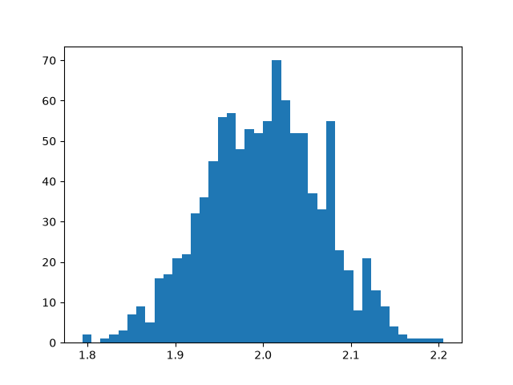
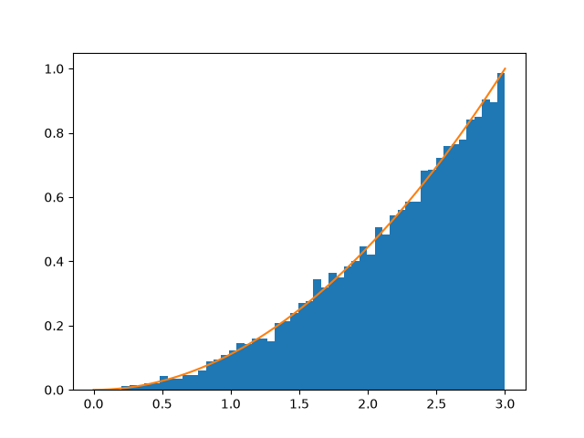

# Od statystyki do ML

Moja ścieżka nauki od klasycznej ekonometrii do podstaw uczenia maszynowego. Każdą metodę najpierw wyprowadzam ręcznie, a potem implementuję od zera w NumPy, bez gotowych bibliotek typu `statsmodels` czy `scikit-learn`.

## Struktura

```
stats-to-ml/
├── README.md
├── requirements.txt
└── faza1_mnk/
    ├── mnk.py            # funkcja mnk(x, y): regresja MNK w zapisie macierzowym
    ├── symulacja_mc.py   # symulacja Monte Carlo rozkładu estymatora b1
    └── histogram.png     # wynik symulacji
```

## Faza 1: Metoda najmniejszych kwadratów

### `mnk.py`
Regresja liniowa ze stałą dla dowolnej liczby zmiennych objaśniających, liczona wzorem

$$b = (X^TX)^{-1}X^Ty$$

Funkcja zwraca wektor parametrów, reszty, $R^2$ i skorygowane $R^2$. Poprawność sprawdzana na dwóch zestawach danych:
- jedna zmienna: wynik zgodny z obliczeniami ręcznymi ($b_0 = 1{,}8$, $b_1 = 0{,}8$, $R^2 = 0{,}727$),
- dwie zmienne, dane bez szumu wygenerowane z $y = 1 + 2x_1 + 3x_2$: funkcja odtwarza $b = (1, 2, 3)$ i $R^2 = 1$.

Kontrola wewnętrzna: warunek optymalności $X^Te = 0$ (suma reszt i suma iloczynów reszt ze zmiennymi równe zeru).

### `symulacja_mc.py`
Symulacja Monte Carlo zachowania estymatora MNK. Prawdziwy model:

$$y = 1 + 2x + \varepsilon, \quad \varepsilon \sim N(0, \sigma^2)$$

Wartości $x$ są stałe, a w każdym z 1000 powtórzeń losowany jest nowy szum i liczone nowe $b_1$.

| Wariant | $n$ | $\sigma$ | Średnia $b_1$ | Odchylenie std. $b_1$ |
|---|---|---|---|---|
| bazowy | 30 | 2 | 2,001 | 0,127 |
| większy szum | 30 | 6 | 2,004 | 0,382 |
| więcej danych | 120 | 2 | 2,001 | 0,066 |



**Wnioski:**
- średnia oszacowań pokrywa się z prawdziwą wartością 2 we wszystkich wariantach,
- rozrzut rośnie proporcjonalnie do $\sigma$ (szum ×3 → rozrzut ×3),
- rozrzut maleje w przybliżeniu jak $1/\sqrt{n}$ (dane ×4 → rozrzut ×½).

Obie reguły są zgodne ze wzorem na błąd standardowy

$$SE(b_1) = \frac{\sigma}{\sqrt{\sum (x_i - \bar x)^2}}$$

## Uruchomienie

```
pip install -r requirements.txt
python faza1_mnk/mnk.py
python faza1_mnk/symulacja_mc.py
```

## Faza 2: Zmienne losowe ciągłe

Rozkład o gęstości $f(x) = x^2/9$ na $[0, 3]$, analizowany trzema metodami.

**Całkowanie numeryczne (metoda punktu środkowego).** Błąd maleje jak $1/N^2$:

| $N$ | Błąd $P(1 \le X \le 2)$ |
|---|---|
| 10 | $9{,}26 \cdot 10^{-5}$ |
| 100 | $9{,}26 \cdot 10^{-7}$ |
| 1000 | $9{,}26 \cdot 10^{-9}$ |

**Mediana metodą bisekcji.** 22 iteracje dla tolerancji $10^{-6}$; wynik $2{,}3811017$ przy dokładnym $\sqrt[3]{13{,}5} = 2{,}3811016$.

**Losowanie metodą odwracania dystrybuanty** ($x = 3u^{1/3}$, $n = 10\,000$):

| Statystyka | Teoria | Próba |
|---|---|---|
| Średnia | 2,25 | 2,245 |
| Mediana | 2,381 | 2,378 |
| $P(X > 2)$ | 0,704 | 0,699 |



## Faza 3: Własności estymatora MNK

**Nieobciążoność.** Z zapisu $b_1 = \beta_1 + \sum w_i \varepsilon_i$ wynika $E[b_1] = \beta_1$, o ile $E[\varepsilon_i] = 0$.

| Wariant składnika losowego | $E[b_1]$ z teorii | Średnia z Monte Carlo |
|---|---|---|
| $E[\varepsilon] = 0$ | 2,00 | 2,0006 |
| $E[\varepsilon] = 0{,}5$ | 2,00 (przesunięcie trafia w $b_0$) | 2,0000 |
| $E[\varepsilon] = 0{,}3x$ | 2,30 (obciążenie) | 2,3000 |

**Błąd standardowy.** $SE(b_1) = \sigma / \sqrt{\sum (x_i - \bar x)^2}$, przy homoskedastyczności i braku autokorelacji.

| Zakres $x$ | $SE$ z teorii | Odchylenie z Monte Carlo |
|---|---|---|
| $[0, 10]$ | 0,1255 | 0,1259 |
| $[0;\ 2{,}5]$ | 0,5020 | 0,5038 |

## Plan

## Plan

- [x] **Faza 1:** MNK: wyprowadzenie, zapis macierzowy, R², implementacja
- [x] **Faza 2:** zmienne ciągłe: gęstość, całkowanie numeryczne, mediana, wariancja, losowanie z rozkładu
- [ ] **Faza 3:** wnioskowanie (prawie gotowe)
  - [x] nieobciążoność b1, wzór na SE(b1)
  - [x] test t i p-value, własna tabelka regresji (zgodna ze statsmodels)
  - [x] przedziały ufności
  - [ ] test F
  - [x] **Moduł A: audyt próbkowy**
    - [x] przedział ufności dla odsetka wadliwych rekordów
    - [x] symulacja trafności: 94,5% przy n=400, tylko 77,5% przy n=50
    - [x] kalkulator wielkości próby (np. ±0,5 pp przy 4% wad → 5901 rekordów)
- [ ] **Faza 4:** diagnostyka (w trakcie)
  - [x] autokorelacja, Durbin–Watson, model w różnicach
  - [ ] heteroskedastyczność
  - [ ] współliniowość (VIF)
  - [ ] zmienne pominięte
  - [ ] **Moduł B: audyt jakości danych.** Raport braków, duplikatów, outlierów i rozkładów kolumn (pandas, Streamlit)
  - [ ] **Moduł C: wycena danych regresją.** Regresja hedoniczna ceny zbioru od jego cech
- [ ] **Faza 5:** szeregi czasowe: stacjonarność, ADF, ARIMA, bootstrap reszt, prognozy Monte Carlo
- [ ] **Moduł D: wykrywanie danych osobowych.** PESEL, NIP, e-mail, telefon; potem nazwy własne w tekście
- [ ] **Faza 6:** wstęp do ML: funkcja straty, gradient descent, Ridge i Lasso, walidacja krzyżowa
  - [ ] **Moduł E: wartość danych dla modelu.** Krzywe uczenia, model z danym zbiorem i bez niego
- [ ] **Tor równoległy (opcjonalnie):** SQL, duże pliki (parquet), automatyzacja przetwarzania
