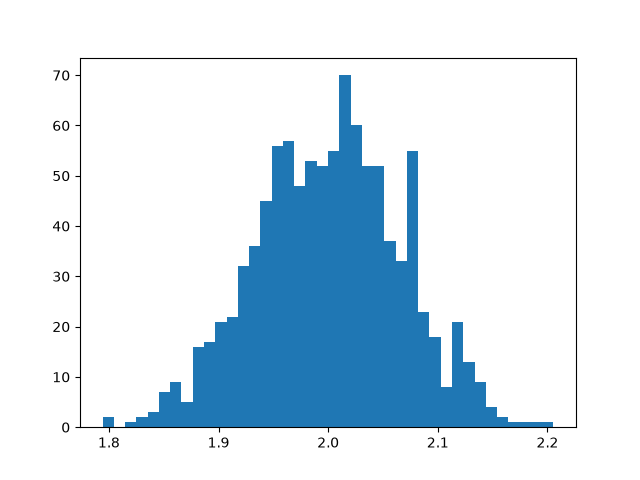

# Od statystyki do ML

Moja ścieżka nauki od klasycznej ekonometrii do podstaw uczenia maszynowego. Każdą metodę najpierw wyprowadzam ręcznie, a potem implementuję od zera w NumPy, bez gotowych bibliotek typu `statsmodels` czy `scikit-learn`.

## Struktura

```
stats-to-ml/
├── README.md
├── requirements.txt
└── faza1_mnk/
    ├── mnk.py            # funkcja mnk(x, y): regresja MNK w zapisie macierzowym
    ├── symulacja_mc.py   # symulacja Monte Carlo rozkładu estymatora b1
    └── histogram.png     # wynik symulacji
```

## Faza 1: Metoda najmniejszych kwadratów

### `mnk.py`
Regresja liniowa ze stałą dla dowolnej liczby zmiennych objaśniających, liczona wzorem

$$b = (X^TX)^{-1}X^Ty$$

Funkcja zwraca wektor parametrów, reszty, $R^2$ i skorygowane $R^2$. Poprawność sprawdzana na dwóch zestawach danych:
- jedna zmienna: wynik zgodny z obliczeniami ręcznymi ($b_0 = 1{,}8$, $b_1 = 0{,}8$, $R^2 = 0{,}727$),
- dwie zmienne, dane bez szumu wygenerowane z $y = 1 + 2x_1 + 3x_2$: funkcja odtwarza $b = (1, 2, 3)$ i $R^2 = 1$.

Kontrola wewnętrzna: warunek optymalności $X^Te = 0$ (suma reszt i suma iloczynów reszt ze zmiennymi równe zeru).

### `symulacja_mc.py`
Symulacja Monte Carlo zachowania estymatora MNK. Prawdziwy model:

$$y = 1 + 2x + \varepsilon, \quad \varepsilon \sim N(0, \sigma^2)$$

Wartości $x$ są stałe, a w każdym z 1000 powtórzeń losowany jest nowy szum i liczone nowe $b_1$.

| Wariant | $n$ | $\sigma$ | Średnia $b_1$ | Odchylenie std. $b_1$ |
|---|---|---|---|---|
| bazowy | 30 | 2 | 2,001 | 0,127 |
| większy szum | 30 | 6 | 2,004 | 0,382 |
| więcej danych | 120 | 2 | 2,001 | 0,066 |



**Wnioski:**
- średnia oszacowań pokrywa się z prawdziwą wartością 2 we wszystkich wariantach,
- rozrzut rośnie proporcjonalnie do $\sigma$ (szum ×3 → rozrzut ×3),
- rozrzut maleje w przybliżeniu jak $1/\sqrt{n}$ (dane ×4 → rozrzut ×½).

Obie reguły są zgodne ze wzorem na błąd standardowy

$$SE(b_1) = \frac{\sigma}{\sqrt{\sum (x_i - \bar x)^2}}$$

## Uruchomienie

```
pip install -r requirements.txt
python faza1_mnk/mnk.py
python faza1_mnk/symulacja_mc.py
```

## Plan

- [x] **Faza 1:** MNK: wyprowadzenie, zapis macierzowy, $R^2$, implementacja
- [ ] **Faza 2:** rachunek prawdopodobieństwa, zmienne ciągłe, metoda największej wiarygodności
- [ ] **Faza 3:** twierdzenie Gaussa–Markowa i wnioskowanie w regresji
- [ ] **Faza 4:** diagnostyka: współliniowość, heteroskedastyczność, autokorelacja
- [ ] **Faza 5:** szeregi czasowe
- [ ] **Faza 6:** wstęp do ML: funkcje straty, gradient descent, Ridge i Lasso, walidacja krzyżowa
