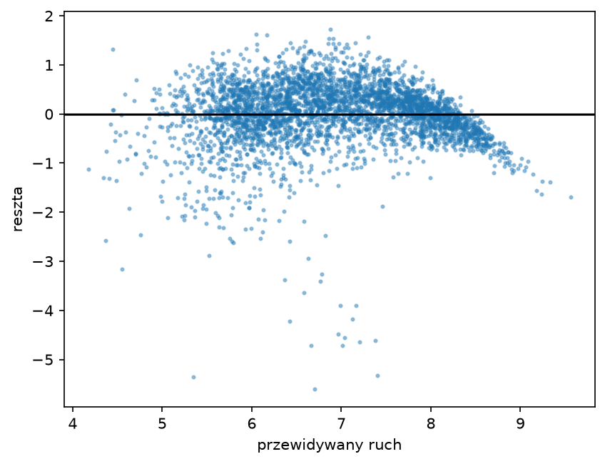

# Ruch rowerowy w Krakowie a pogoda

**Pytanie:** jak pogoda i dzień tygodnia wpływają na liczbę rowerzystów w Krakowie? Czy trasa rekreacyjna reaguje inaczej niż trasa, którą ludzie dojeżdżają do pracy?

**Odpowiedź w jednym zdaniu:** Bulwary to trasa „pogodowa”, Mogilska to trasa „kalendarzowa”. Na Bulwarach mocniej działają ciepło i deszcz, a na Mogilskiej w weekend ruch spada o połowę.


## Najważniejsze wyniki

Model: `log(rowery) ~ temperatura + opady + dzień tygodnia`, błędy standardowe Neweya–Westa. Wyniki jako zmiana procentowa liczby rowerzystów.

| Czynnik | Bulwary (rekreacja) | Mogilska (dojazdy) |
|---|---|---|
| temperatura, +1°C | **+12,4%** | +8,2% |
| opady, +1 mm | **−4,8%** | −3,2% |
| sobota (vs poniedziałek) | −13,8% | **−46,9%** |
| niedziela (vs poniedziałek) | −1,7% | **−47,6%** |
| wtorek–czwartek (vs poniedziałek) | +7 do +9% | +5 do +8% |

Wnioski:
- **Bulwary są bardziej wrażliwe na pogodę**: na każdy stopień ciepła przybywa o połowę więcej rowerzystów (w procentach) niż na Mogilskiej, a deszcz odstrasza ich mocniej.
- **Mogilska żyje rytmem pracy**: w weekend ruch spada prawie o połowę. Na Bulwarach niedziela jest praktycznie taka jak dzień roboczy, bo ubytek dojeżdżających zastępują rekreacyjni.
- **Bulwary nie są czysto rekreacyjne**: w środku tygodnia ruch jest tam o około 7% wyższy niż w poniedziałek, więc część osób jeździ nimi do pracy.

## Dane

| Źródło | Zawartość | Okres |
|---|---|---|
| [ZTP Kraków – pomiary ruchu rowerowego](https://ztp.krakow.pl/rower/pomiary-ruchu-rowerowego/dane-tabelaryczne) | dzienna liczba rowerzystów z 20 liczników + pogoda | 18.11.2016 – 31.10.2026 |
| [Open-Meteo Historical Weather API](https://open-meteo.com/) | dzienna temperatura średnia i suma opadów dla Krakowa | ten sam okres |

Do analizy wybrałem dwa liczniki z pełnymi 10 latami danych: **Bulwary** (trasa w dużej mierze rekreacyjna) i **Mogilska** (trasa w dużej mierze dojazdowa).

## Przebieg analizy

### 1. Audyt jakości danych
Dane przepuszczone przez mój [audytor jakości danych](https://audytor-danych.streamlit.app/).

| Problem | Skąd się wziął | Co zrobiłem |
|---|---|---|
| kolumna `Dworzec Główny` wczytana jako tekst | **jedna spacja** w komórce z 22.11.2016 | zamiana na liczby, spacja → brak danych |
| dużo braków w części liczników | liczniki uruchamiane w różnych latach (to nie błąd) | analiza tylko na licznikach z pełnym okresem |
| 245 dni bez pogody | luka w danych ZTP od marca do października 2026 | uzupełnienie z Open-Meteo |
| setki „outlierów” w opadach | reguła 3·IQR nie pasuje do zmiennej skośnej (ponad połowa dni bez deszczu) | to nie są błędy; reguły nie stosuję do opadów |
| dni z zerową liczbą rowerów | najpewniej awarie licznika | usunięte przed logarytmowaniem |

### 2. Porównanie dwóch źródeł pogody
Przez 9 lat pogoda jest dostępna i z ZTP, i z Open-Meteo, więc można sprawdzić, czy mówią to samo:

| Wielkość | Korelacja | Uwagi |
|---|---|---|
| temperatura | **0,995** | ZTP średnio o 0,25°C chłodniejsze |
| opady | **0,63** | deszcz jest lokalny; stacja i siatka modelu to różne miejsca |

Temperaturę można bezpiecznie uzupełniać z Open-Meteo. Opady za 2026 są mniej pewne.

### 3. Pierwszy model: liniowy
`rowery ~ temperatura + padało (0/1) + dzień tygodnia` dla Bulwarów: R² = 0,71, +122 rowery na 1°C, −682 rowery w deszczowy dzień.

### 4. Diagnostyka


| Test | Wynik | Wniosek |
|---|---|---|
| Durbin–Watson | 1,36 | dodatnia autokorelacja: dzisiejszy ruch przypomina wczorajszy |
| test White'a | LM = 412,7, p ≈ 10⁻⁷⁴ | silna heteroskedastyczność: latem wahania o tysiące, zimą o setki |
| wykres reszt | lejek + ukośna linia | model liniowy przewiduje **ujemny** ruch w mroźne dni |

Poprawki:
- **błędy standardowe Neweya–Westa** (odporne na oba problemy naraz): SE temperatury wzrosło o 63%, ale wszystkie główne wnioski pozostały istotne,
- **model logarytmiczny**: prognozy nie mogą być ujemne, a współczynniki czyta się jako procenty, co pozwala uczciwie porównać trasy o różnej skali ruchu.

### 5. Ciekawostka: dwa modele, dwie „niedziele”
Model liniowy mówi, że w niedzielę na Bulwarach jest **o 416 rowerów więcej** niż w poniedziałek, a logarytmiczny, że **o 1,7% mniej**. Oba mają rację. Latem niedziela to tłum, więc w sztukach różnica jest duża. Zimą w niedzielę mało kto jedzie rekreacyjnie i ruch jest niższy niż w dzień roboczy. Model liniowy jest zdominowany przez duże letnie liczby, a logarytmiczny traktuje wszystkie pory roku równo. Wniosek: **efekt niedzieli zależy od pory roku** (interakcja), co jest dobrym kierunkiem rozszerzenia.

## Ograniczenia
- Opady za marzec–październik 2026 pochodzą z modelu Open-Meteo, a nie ze stacji, i są mniej dokładne.
- Model nie uwzględnia wakacji, świąt ani wydarzeń (np. pandemii w 2020).
- Efekt dnia tygodnia jest taki sam przez cały rok; w rzeczywistości zależy od pory roku (patrz punkt 5).
- Wyniki opisują związki w danych, a nie dowodzą przyczynowości.

## Możliwe rozszerzenia
- interakcja temperatury z weekendem (czy ciepła niedziela działa inaczej niż ciepły poniedziałek),
- zmienne dla świąt i wakacji szkolnych,
- pozostałe liczniki: mapa Krakowa z wrażliwością na pogodę dla każdego punktu.

## Struktura

```
rowery-kraków/
├── dane/
│   ├── liczniki_dzienne.csv     # surowe dane ZTP
│   ├── liczniki_czyste.csv      # po audycie i naprawie
│   └── rowery_pogoda.csv        # połączone z Open-Meteo
├── pobierz_pogode.py            # pogoda z Open-Meteo
├── wczytaj.py                   # wczytanie, audyt, naprawa
├── polacz_dane.py               # porównanie źródeł, uzupełnienie pogody
├── regresja.py                  # model liniowy
├── diagnostyka_bulwary.py       # wykres reszt, White, Newey–West
├── porownanie.py                # Bulwary vs Mogilska
├── ruch_w_czasie.png
├── reszty_bulwary.png
└── README.md
```

## Uruchomienie

```
pip install pandas numpy matplotlib statsmodels requests
python wczytaj.py
python polacz_dane.py
python porownanie.py
```