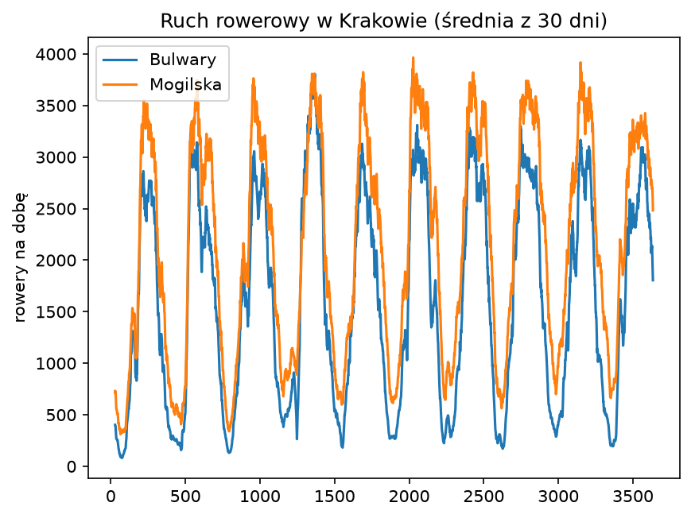

# Ruch rowerowy w Krakowie a pogoda

Jak pogoda, pora roku i dzień tygodnia wpływają na liczbę rowerzystów w Krakowie? Czy trasy rekreacyjne reagują na pogodę inaczej niż trasy, którymi ludzie dojeżdżają do pracy?

Projekt łączy prawie 10 lat dziennych pomiarów z automatycznych liczników rowerowych z danymi pogodowymi i analizuje je metodami ekonometrycznymi.



## Dane

| Źródło | Zawartość | Okres |
|---|---|---|
| [ZTP Kraków – pomiary ruchu rowerowego](https://ztp.krakow.pl/rower/pomiary-ruchu-rowerowego/dane-tabelaryczne) | dzienna liczba rowerzystów z 20 liczników + pogoda (temperatury, opady) | 18.11.2016 – 31.10.2026 |
| [Open-Meteo Historical Weather API](https://open-meteo.com/) | dzienna temperatura średnia i suma opadów dla Krakowa | ten sam okres |

Liczniki działają od różnych dat. Pełne 10 lat danych mają: **Bulwary, Mogilska, Kotlarska, Wadowicka, Wielicka**. Do analizy wybrałem:
- **Bulwary**: trasa w dużej mierze rekreacyjna,
- **Mogilska**: trasa w dużej mierze dojazdowa.

## Co zostało zrobione

### 1. Pobranie pogody (`pobierz_pogode.py`)
Funkcja pobierająca dzienną pogodę dla dowolnego okresu z archiwum Open-Meteo (bez klucza API).

### 2. Wczytanie i audyt jakości danych (`wczytaj_dane.py`)
Dane przepuszczone przez mój [audytor jakości danych](../Audyt/). Znalezione problemy:

| Problem | Skąd się wziął | Co zrobiłem |
|---|---|---|
| kolumna `Dworzec Główny` wczytana jako tekst | **jedna spacja** w komórce z 22.11.2016 | zamiana na liczby, spacja → brak danych |
| dużo braków w części liczników | liczniki uruchamiane w różnych latach (to nie błąd) | analiza tylko na licznikach z pełnym okresem |
| 245 dni bez pogody w danych ZTP | luka od marca do października 2026 | uzupełnienie z Open-Meteo (krok 4) |
| setki „outlierów” w opadach | reguła 3·IQR nie pasuje do zmiennej skośnej (ponad połowa dni bez deszczu) | to nie są błędy, reguły nie stosuję do opadów |
| przecinki dziesiętne w kolumnach pogody | format pliku źródłowego | `read_csv(..., decimal=",")` |

Najciekawsza lekcja: jedna niewidoczna spacja zamieniła całą kolumnę z ponad 3000 pomiarów w tekst, a audytor po cichu pominął ją przy sprawdzaniu liczb.

### 3. Pierwszy wykres (`pierwszy_wykres.py`)
30-dniowa średnia krocząca ruchu na Bulwarach i Mogilskiej. Wnioski:
- **Silna sezonowość** na obu trasach.
- **Bulwary są dużo bardziej „pogodowe”**: latem około 15 razy więcej rowerów niż zimą. Na Mogilskiej około 6 razy, bo część osób jeździ do pracy przez cały rok.
- **Wiosna 2020**: wyraźny spadek w czasie lockdownu, a zaraz potem jedno z najwyższych lat.

### 4. Połączenie z Open-Meteo (`polacz_dane.py`)
Przez 9 lat pogoda jest dostępna z obu źródeł naraz, więc można sprawdzić, czy mówią to samo:

| Wielkość | Korelacja ZTP – Open-Meteo | Uwagi |
|---|---|---|
| temperatura średnia | **0,995** | ZTP średnio o 0,25°C chłodniejsze |
| suma opadów | **0,63** | deszcz jest lokalny; stacja i siatka modelu to różne miejsca |

Wniosek: temperaturę można bez obaw uzupełniać z Open-Meteo. Opady są mniej pewne, dlatego w regresji rozważam zmienną „padało / nie padało” zamiast milimetrów.

Wynik: `dane/rowery_pogoda.csv`, czyli komplet danych bez braków w pogodzie.

## Plan

- [x] pobranie pogody z Open-Meteo
- [x] wczytanie i audyt jakości danych z liczników
- [x] pierwszy wykres: sezonowość
- [x] połączenie źródeł i uzupełnienie brakującej pogody
- [ ] regresja: ruch ~ temperatura + deszcz + dzień tygodnia
- [ ] diagnostyka: autokorelacja, heteroskedastyczność, odporne błędy standardowe
- [ ] porównanie: Bulwary (rekreacja) vs Mogilska (dojazdy). Kto bardziej przejmuje się deszczem?
- [ ] hipoteza: czy remonty w 2026 przesunęły ruch na sąsiednie liczniki?

## Ograniczenia
- Opady za marzec–październik 2026 pochodzą z modelu Open-Meteo, a nie ze stacji ZTP, i są mniej dokładne.
- Liczniki mogą mieć awarie (dni z zerami); jeszcze nieobsłużone.

## Struktura

```
rowery_krakow/
├── dane/
│   ├── liczniki_dzienne.csv     # surowe dane ZTP
│   ├── liczniki_czyste.csv      # po audycie i naprawie
│   └── rowery_pogoda.csv        # połączone z Open-Meteo
├── pobierz_pogode.py
├── wczytaj_dane.py
├── pierwszy_wykres.py
├── polacz_dane.py
├── ruch_w_czasie.png
└── README.md
```

## Uruchomienie

```
pip install pandas matplotlib requests
python wczytaj_dane.py
python polacz_dane.py
python pierwszy_wykres.py
```